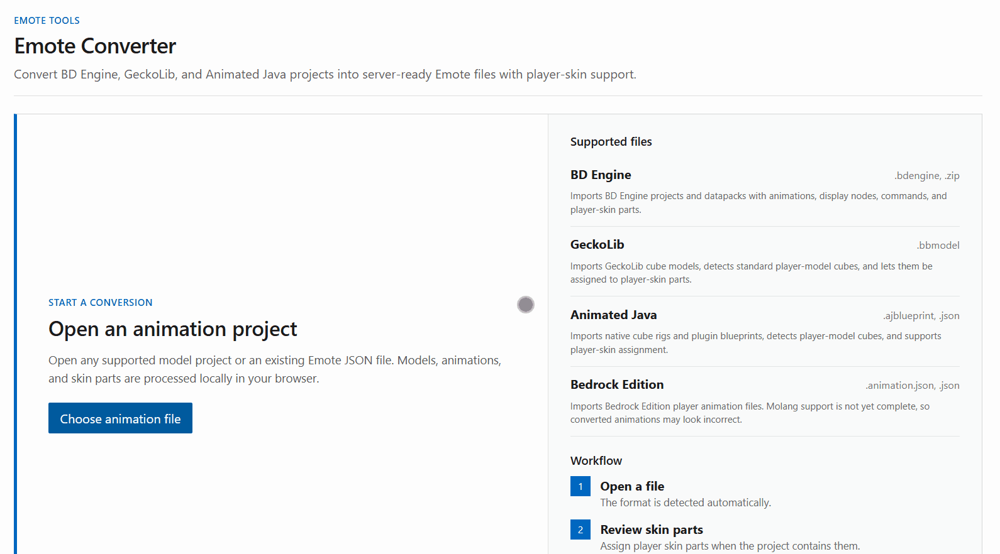
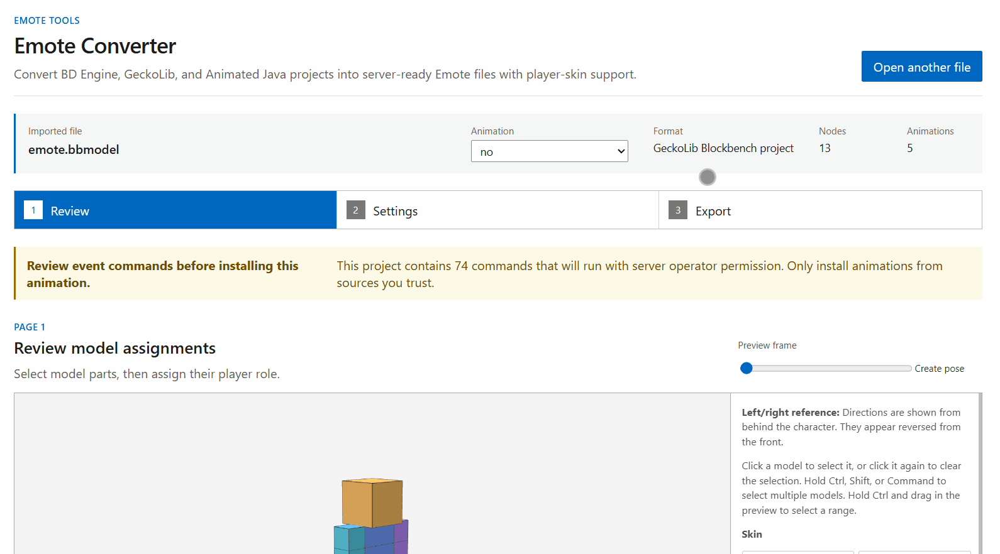
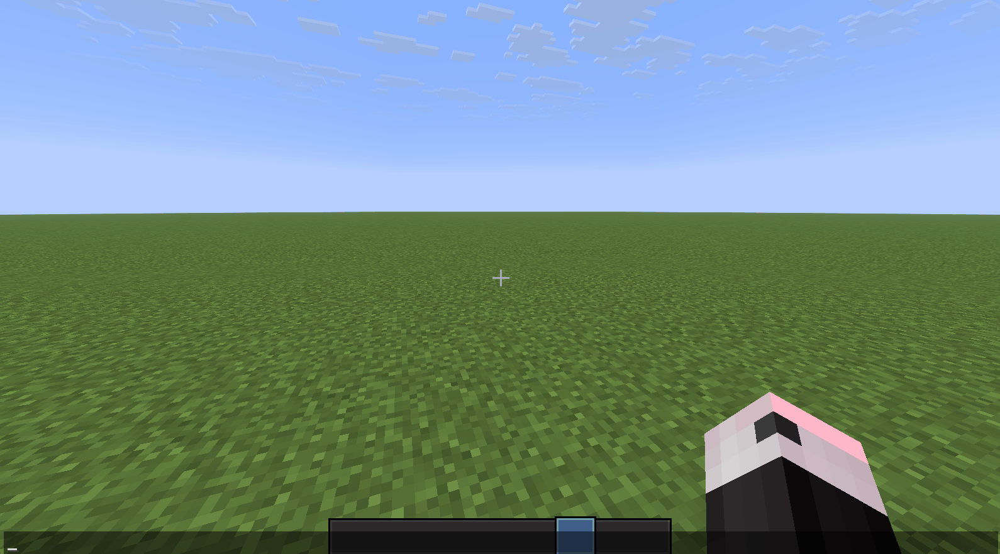

# Adding Custom Emotes

To use your own animation, convert the source project to Emote JSON with the [Emote Converter](https://hanhy06.github.io/emote/converter/), then install the exported files on the server. Conversion is performed locally in your browser.

## Supported formats

| Source format | Files | Input |
|---|---|---|
| BD Engine | `.zip` | Animation datapack exported from BD Engine |
| GeckoLib | `.bbmodel` | Original Blockbench project in GeckoLib format |
| Animated Java | `.ajblueprint` | Original Animated Java project |
| Bedrock Edition | `.json` | Player animation JSON; experimental support |
| Emotecraft | `.emotecraft` | Emotecraft file; experimental support |

## 1. Open files

Select **Choose animation files** in the converter and open one or more source projects. Their formats and animations are detected automatically. If the imported files contain multiple animations, use the **Animation** menu at the top to select the animation you want to configure.



!!! warning "Use files from trusted sources"
    Event commands in the source file may run with server operator permission. Review any command warning shown after import, and install animations only from sources you trust.

## 2. Configure and export

In **Review**, select model parts and verify their player-skin assignments. You can reassign any parts that were detected incorrectly.

In **Settings**, configure the ID, name, description, and playback behavior. The ID must use the `namespace:path` format and must not duplicate another emote on the server.

When the configuration is complete, use **Export** to download the Animation JSON. To connect multiple animations as one emote, configure a Sequence and download it together with every Animation it references.



## 3. Install on the server

Place the exported JSON files under `config/emote/emote/`.

When an animation requires additional resources, the converter also downloads a `*.resources.zip` file. Place it under `config/emote/resource-pack/`. Install [Polymer](https://polymer.pb4.eu/latest/) to send these resources to players automatically.

!!! note "Polymer is optional"
    The emotes bundled with Emote do not require a resource pack.<br>If none of your custom emotes use additional resources, Polymer does not need to be installed.

```text
config/emote/
├── emote/
└── resource-pack/
```

Run `/emote reload`, then use `/emote list` to confirm that the emote loaded successfully. To make it available to normal players, include its ID in a permission group in `emotes.json`. See [Access Control](access-control.md) for details.



If the emote does not load, check the `/emote reload` result and the server log. Invalid JSON, duplicate IDs, and missing Animations referenced by a Sequence each prevent the affected emote from loading.
