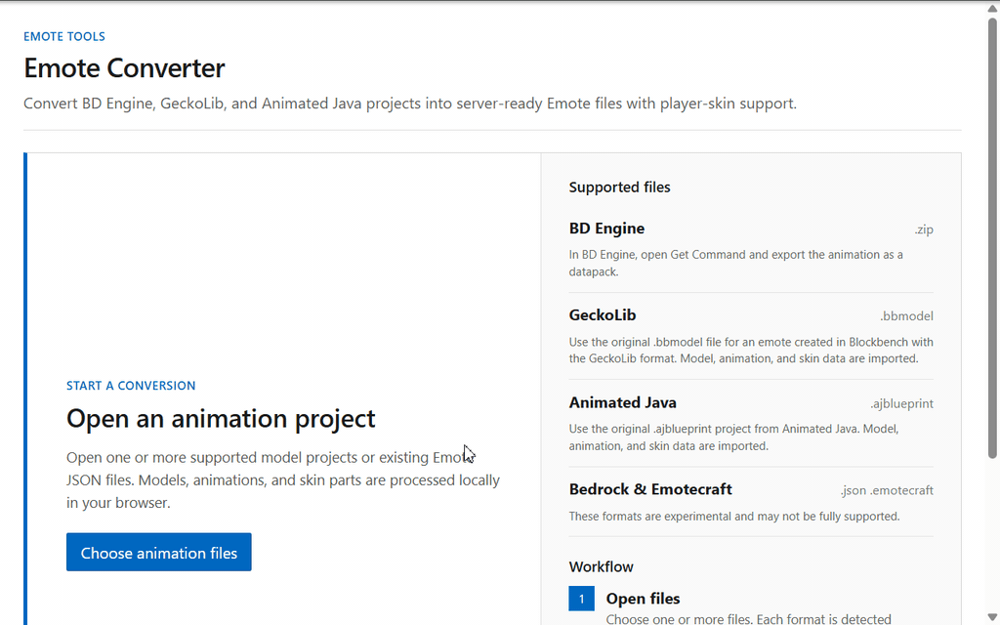
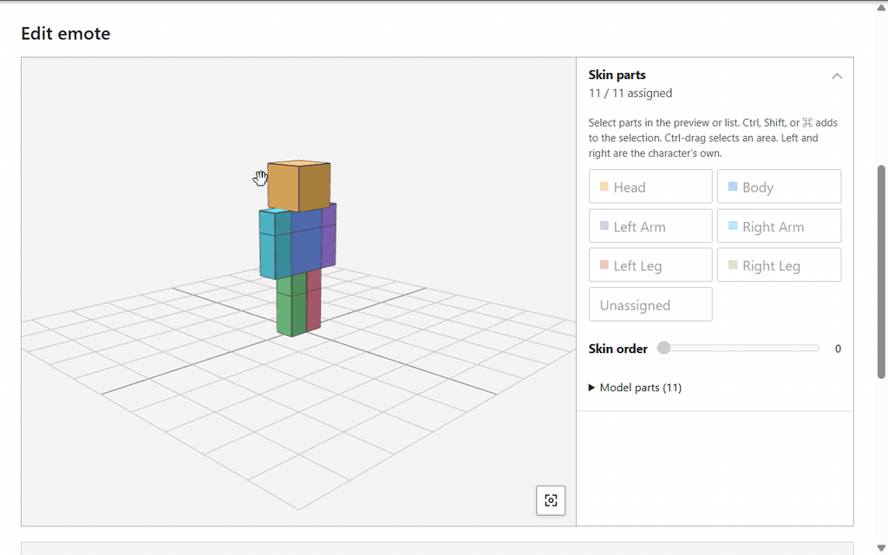
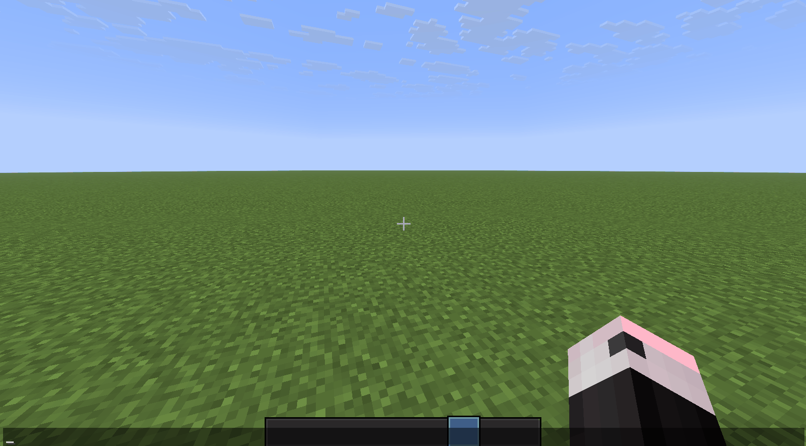

# Adding Custom Emotes

To use your own animation, convert the source project to Emote JSON with the [Emote Converter](https://docs.hanhy06.kr/emote/converter/), then install the exported files on the server. Conversion is performed locally in your browser.

## Supported formats

| Source format | Files | Input |
|---|---|---|
| BD Engine | `.zip` | Animation datapack exported from BD Engine |
| GeckoLib | `.bbmodel` | Original Blockbench project in GeckoLib format |
| Animated Java | `.ajblueprint` | Original Animated Java project |
| Bedrock Edition | `.json` | Player animation JSON; experimental support |
| Emotecraft | `.emotecraft` | Emotecraft file; experimental support |

## 1. Open files

Select **Choose animation files** in the converter and open one or more source projects. Their formats and animations are detected automatically. If the files contain multiple animations, use the **Emote** menu to choose one. Set **Minecraft version** to the version your server runs.



!!! warning "Use files from trusted sources"
    Event commands in the source file may run with server operator permission. Review any command warning shown after import, and install animations only from sources you trust.

## 2. Configure and export

On the **Edit** page, select a model part in the preview or the **Model parts** list. If its skin assignment is incorrect, choose the matching body part under **Skin parts**. Move the **Frame** slider to check the pose at another point in the animation.

Under **Settings**, set the **Namespace**, **Display name**, **Description**, and **Playback mode**. The namespace and the imported animation path form the emote ID. For example, setting the namespace to `demo` for the `clap` animation gives it the ID `demo:clap`. Each emote on the server needs a unique ID.

Use **Options** to choose when the emote stops, such as when the player jumps or takes damage. If the animation contains commands, use **Events** to review them at the selected frame.

!!! info "[Skin overrides](../developers/animation.md#skin)"
    In `.ajblueprint` and `.bbmodel` projects, the `override` texture replaces the areas of the player's skin selected by `override_mask` during emote playback.

Open **Export**, find the animation by name and ID, and select **Download JSON** on its row. To export every animation separately, select **Download all JSON**. To play them in order as one emote, select **Download sequence files** to download the Sequence and its animations together.



## 3. Install on the server

Place the exported JSON files under `config/emote/emote/`.

When an animation requires additional resources, the converter also downloads a `*.resources.zip` file. Place it under `config/emote/resource-pack/`. Install [Polymer](https://polymer.pb4.eu/latest/) to send these resources to players automatically.

!!! note "Polymer is optional"
    The emotes bundled with Emote do not require a resource pack.<br>If none of your custom emotes use additional resources, Polymer does not need to be installed.

```text
config/emote/
├── emote/
└── resource-pack/
```

Run `/emote reload`, then use `/emote list` to confirm that the emote loaded successfully. To make it available to normal players, include its ID in a permission group in `emotes.json`. See [Access Control](access-control.md) for details.



If the emote does not load, check the `/emote reload` result and the server log. Invalid JSON, duplicate IDs, and missing Animations referenced by a Sequence each prevent the affected emote from loading.
